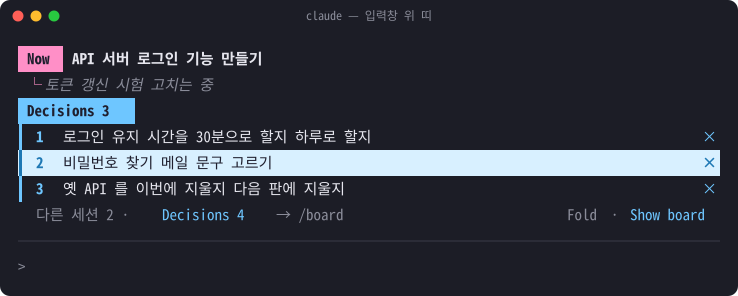
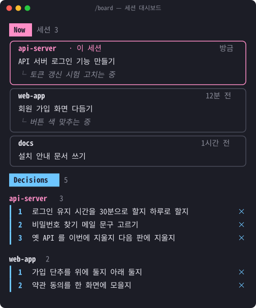

# session-board

Claude Code 입력창 위에 **이 세션에서 지금 하는 일(Now)** 과 **사용자가 정할 것(Decisions)** 을 띄우는 mod.
세션의 Claude 가 `set_board` 도구로 직접 갱신한다 — 새 일을 시작할 때, 단계가 바뀔 때, 정할 것이 생기거나 정해졌을 때.



`Show board` 나 `/board` 로 여는 대시보드 — 이 mod 가 켜진 모든 세션이 모인다.



- 띠: 핑크 `Now` · 하늘색 `Decisions` 딱지, 정할 것마다 `×` 로 빼기, 아래 줄 오른쪽에 `Fold` · `Show board` 단추
- `/board` (또는 `[Board]`): 이 mod 가 켜진 모든 세션의 Now · Decisions 를 모아 보여 주는 옆 창
- 세션 내용은 `~/.claude/session-board/<세션 id>.json` 에 적힌다. 끝난 세션과 하루 넘게 갱신이 없는 세션은 빠진다.
- Claude 에게 주는 안내문과 화면 글은 한국어다.

## 설치

Claude Code 터미널 입력창에서:

```
/plugin install session-board --marketplace keh7264/session-board
```

셸에서:

```
claude plugin install session-board --marketplace keh7264/session-board
```

데스크톱 앱(`/plugin` 이 안 될 때): 입력창 옆 + → Plugins → Add marketplace 에 `keh7264/session-board` → Add plugin.

설치한 뒤 새로 여는 세션부터 켜진다.

## License

MIT
